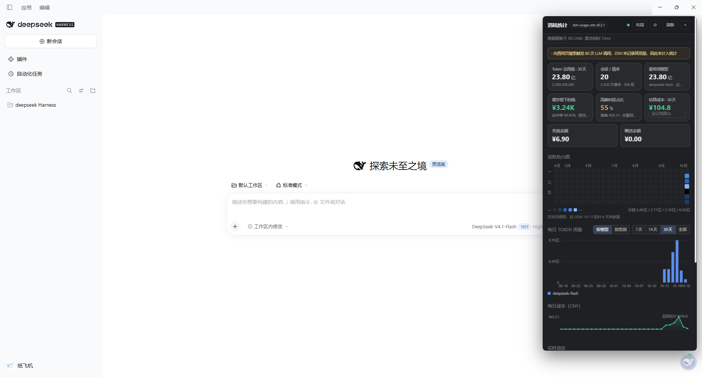
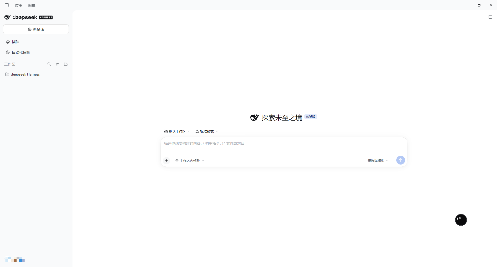
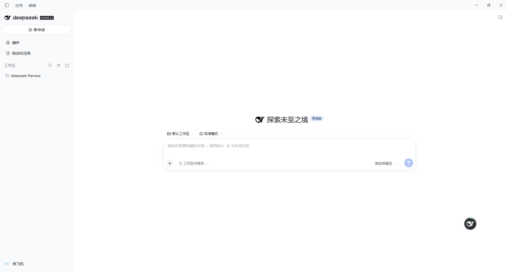

<p align="center">
  
</p>

# dsh-usage-orb

**DSH 用量光球** —— 常驻右下角的圆形进度环 + 可拖动的用量面板。
跨会话统计 token / 缓存命中率 / 成本 / 余额，全部数据只从本地日志读取。

[](LICENSE)
[](https://awesome-dsh-plugin.com)

| | |
|---|---|
|  |  |
|  |  |

## 这是什么

DSH 自带的用量胶囊只显示**当前会话**的账。本插件读取全部会话日志做跨会话聚合，
补上"这周一共用了多少""缓存帮我省了多少钱""钱都烧在哪个工具上"这类原生给不了的视图。

- **常驻圆环**：右下角一个环，悬停即看余额百分比；画面会呼吸/扫圈提示状态
- **跨会话用量**：token 四分类、会话/请求/轮次、按模型拆分、缓存命中率
- **成本与省钱**：按模型计价估算（人民币）、缓存省下的钱、峰谷占比与"把高峰挪到空闲"模拟器
- **余额追踪**：水位曲线、掉血与充值提示（需 DSH 账户服务可用）
- **工具烧钱榜**：把成本归因到具体工具/命令，含失败率
- **磁贴 DIY**：iOS 控制中心式直接编辑 —— 拖卡片重排、拖右下角把手改宽高、⊙ 隐藏
- **可拖动按钮**：位置按比例记忆，双击复位
- **按钮面孔**：内置图标，或 bloub 机器人（眼睛追光标、被戳会弹、你久不动它会困）
- **等级条**：累计 token 分 Lv.1–6，附连续使用天数与今日强度
- **余额血条**：以历史最高水位为满格，见底会呼吸告警
- **点按热力图**看当天明细（token / 成本 / 请求 / 模型占比）
- **分享卡片**：导出一张只含聚合数字的 PNG
- **简洁 / 详细**两档文案密度；15 项玩法开关

> 截图取自作者本机（真实使用数据），只包含聚合数字与面板界面本身，不含会话内容。


## 目录结构

```
D:\path\to\dsh-usage-orb\
├── package.json         插件元数据（dsh.bundle / dsh.client / peerDependencies）
├── cordis.patch.yml     叠加层：把插件插入 Loader
├── lib\
│   ├── index.js         host 侧：读会话文件、聚合四类 token
│   └── client.js        client 侧：右侧栏按钮 + 自建面板（手写 CJS，无需打包）
└── README.md
```

**零依赖、零构建步骤**：两端都只使用 Node 内置模块和宿主提供的 `react`。
不需要 `pnpm install`，不需要编译。

---

## 安装

### 桌面端（DeepSeek Harness 应用）

桌面端的 profile 由应用独占管理，**不能用 CLI 修改**（会报
`profile "desktop" is managed exclusively by the Electron application`）。
请在应用内操作：

1. 打开左侧栏 **插件** 页面
2. 用「从 GitHub / 本地路径安装」填入本仓库地址：
   `https://github.com/zhifeiNi/dsh-usage-orb`
3. 安装后**重启应用**，右下角出现圆形进度环即成功

装好后可随时在该页面**开关 / 卸载**本插件。

### CLI 或 Web 端（profile 由 CLI 管理时）

```bash
dsh plugin --profile web add github:zhifeiNi/dsh-usage-orb
dsh plugin --profile web remove dsh-usage-orb
```

> `--profile` 换成你实际在用的、且由 CLI 管理的 profile 名。桌面端请用上面的应用内安装。

<details>
<summary>手工安装（旧版 DSH 既不支持应用内安装、也没有 <code>dsh plugin</code> 时）</summary>

```bash
# ① profile 的 package.json 里加依赖（以 desktop 为例）
#    "dependencies": { "dsh-usage-orb": "link:D:/path/to/dsh-usage-orb" }
# ② 同一文件把它加入 bundles
#    "dsh": { "profile": { "bundles": ["@deepseek-ai/dsh-base", "@deepseek-ai/dsh-web-app", "dsh-usage-orb"] } }
# ③ 建软链接（Windows: mklink /J；类 Unix: ln -s）
#    ~/.dsh/profiles/desktop/node_modules/dsh-usage-orb  ->  你的仓库目录
```

手工安装时，`cordis.patch.yml` 里的 `name` 需要改成你的**绝对路径**
（仓库里保留的是包名 `dsh-usage-orb`，只有经包管理器安装时才能被解析）。

</details>

## 预期现象

启动后：

1. **宿主日志**里出现两行：
   ```
   [dsh-usage-orb] host 侧已加载
   [dsh-usage-orb] 自检：扫描 12 个会话文件，采用 9 个，跳过 3 个；合计 857218617 tokens，缓存命中率 99.63%，模型 1 个，有日期的 2 天
   ```
   看到这两行 = host 侧活着、数据读取正确。

2. **对话区顶部工具栏**（复制/点赞/分支按钮那一排）右侧出现一个 **「用量」** 按钮。

3. **点它** → 右上角出现一个固定定位面板，写着"链路已打通"，并显示插件 id、
   React 版本、加载时间。

---

## 排错

| 现象 | 说明 |
|---|---|
| 日志里没有 `[dsh-usage-orb]` | 插件没被加载。检查 patch 路径是否正确、文件是否存在 |
| 有 host 日志但界面没有「用量」按钮 | host 活了但 client bundle 没被物化。最可能是 client 模块发现失败（见下方"已知风险"） |
| 按钮在但点击没反应 | panel host 挂载失败；看浏览器控制台（Ctrl+Shift+I）的报错 |

---

## 已知风险

1. **client 模块的发现机制未实测**。DSH 的 `ctx.clientModules` 扫描 Loader entry 找出声明
   `dsh.client` 的包。我们的插件在 profile 之外、通过 `--patch` 以绝对路径插入，
   其 `package.json` 里的 `dsh.client` **是否会被扫描到尚未验证**。
   若未生效，退路是改成"安装进 profile"的分发方式（`dsh.bundle` + `dsh plugin add`）。

2. **`conversation.session.header.utilities` 这个 slot 名来自第三方插件
   `dsh-ui-workbench` 的实践**，不是从官方文档直接抄的。若该 slot 名在你的版本里不同，
   按钮不会出现——需要按官方 `ui-sidebar-right` 文档改用 `ctx.sidebarRightTabs.register()`。

3. **面板用固定定位自挂载**（借鉴 workbench 的做法），不占用官方 dock 布局。
   好处是链路短、不易冲突；代价是不会参与官方的分栏/全屏切换。

---

## 数据口径

严格沿用 DSH 自己的四类 token 口径，与官方胶囊一致：

```
未缓存输入  uncachedInputTokens   按全价计费的部分
缓存读取    cacheReadTokens       命中缓存的部分
缓存写入    cacheWriteTokens      写入缓存的部分
输出        outputTokens          模型生成的部分

缓存命中率 = 缓存读取 / (未缓存输入 + 缓存读取)
```

**绝不把不同来源的口径相加**——这是从 DSH 官方用量面板学到的原则。

### 实测数据（截至 2026-10-15）

```
扫描 12 个会话文件，采用 9 个
未缓存输入  3,197,603
缓存读取    852,143,488
缓存写入    0
输出        1,877,526
合计        857,218,617
缓存命中率  99.63%
轮次/步数   110 / 1,925
```

**注意 99.63% 的缓存命中率**：这意味着上下文重发几乎全部走缓存价，
真正的全价输入只有约 320 万 token。用量成本几乎完全由缓存命中率决定。

---

## 隐私

- **只读本地**：会话日志（`~/.dsh/storages/` 下的 `*.jsonl`）、插件自己的
  `~/.dsh/usage-panel/` 缓存（余额水位 / 布局偏好 / 报错记录）
- **不联网、无遥测、不上传任何数据**；没有任何第三方统计
- 余额通过 DSH 自己的 `deepseekAccount` 服务读取，**本插件不存储凭据**
- 想彻底重置：删除 `~/.dsh/usage-panel/` 即可

## 免责与兼容性

- **非官方插件**，与 DeepSeek、x.ai 均无隶属、背书或关联关系
- 数据口径依赖 DSH 的**内部实现**（事件流中的 usage 字段、`*.jsonl` 布局）
  → **DSH 升级后可能失效**，届时以新版为准修复
- 按 MIT 提供，**无任何担保**；统计数字仅供观察，不作为账单依据

## 已知限制

- 网页搜索触发的 LLM 调用不计入统计（面板会显式提示"未计入"）
- 余额需要账户服务可用；不可用时静默降级为"仅用量"
- bloub 机器人面孔是**可选外观、默认关闭**（默认使用项目自带图标），
  其代码许可与**设计归属**说明见 [THIRD-PARTY-NOTICES.md](THIRD-PARTY-NOTICES.md)
- 兼容性以 `package.json` 的 `peerDependencies` 为准

## 致谢

- **[bloub](https://github.com/jeremy-prt/bloub)**（MIT，© 2026 Jérémy Perret）——
  机器人表情引擎与几何测量数据。上游声明与 x.ai 无关联，且 MIT 仅覆盖代码、不覆盖其模仿的设计。

## 开发与测试

> 踩坑记录（框架激活契约、插件为何必须可被解析为包、速度/限窗口径）见 [docs/DEVNOTES.md](docs/DEVNOTES.md)。

```bash
npm test          # 三个离线套件（~1 秒，不依赖网络与真实数据，CI 跑这个）
npm run test:e2e  # 端到端：启动真实 DSH + headless Chrome
```

> 测试钩子：`USAGE_PANEL_FAKE_BALANCE='{\"balance\":\"23.32\"}'\` 可让宿主注入一个假余额，仅在 e2e 里使用，正常运行时无影响。

> ⚠️ `test:e2e` **会改动你的环境**：克隆 `~/.dsh/profiles/desktop` 到临时 profile、
> 结束相关进程、写入 `~/.dsh/usage-panel/`，并需要本机已安装 DSH 桌面端
> （可用 `DSH_EXE` / `DSH_APP_ROOT` / `DSH_E2E_OUT` 覆盖路径）。只在你自己的机器上跑。

## 许可

[MIT](LICENSE)。第三方组件与设计归属见 [THIRD-PARTY-NOTICES.md](THIRD-PARTY-NOTICES.md)。
